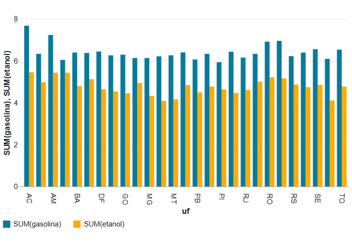
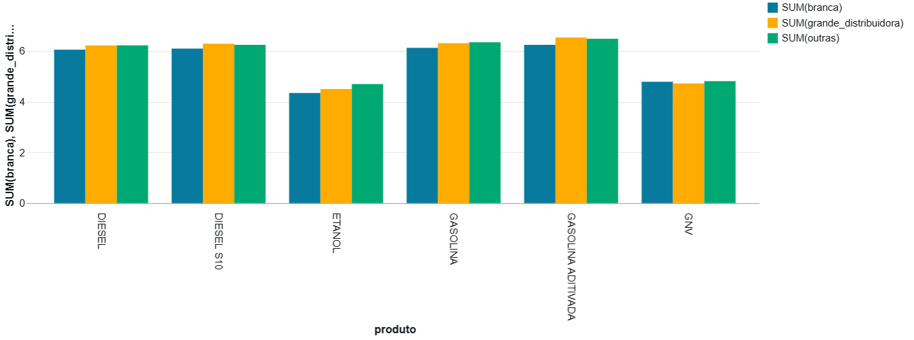
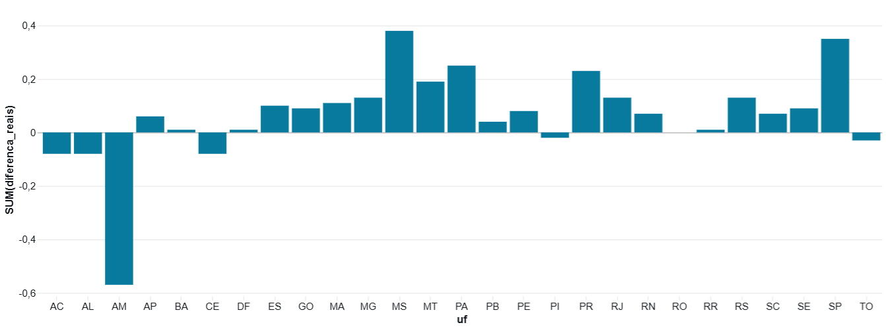
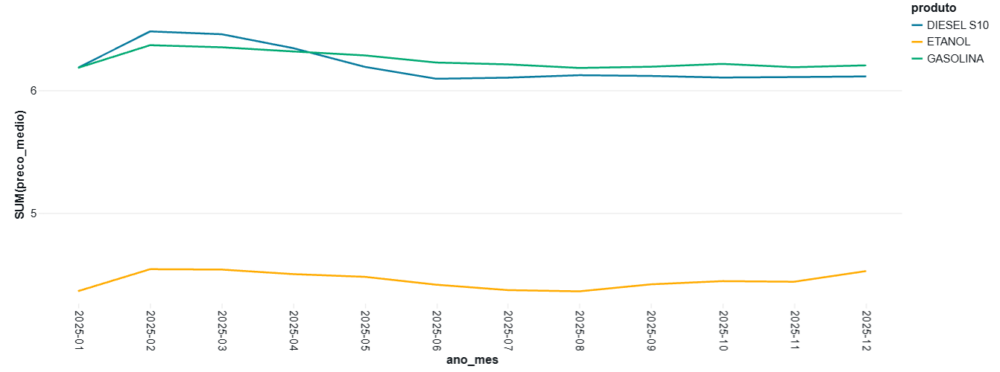
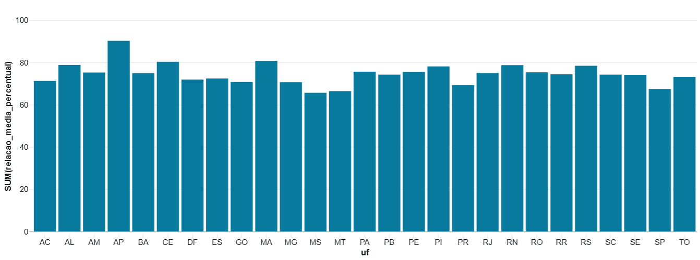
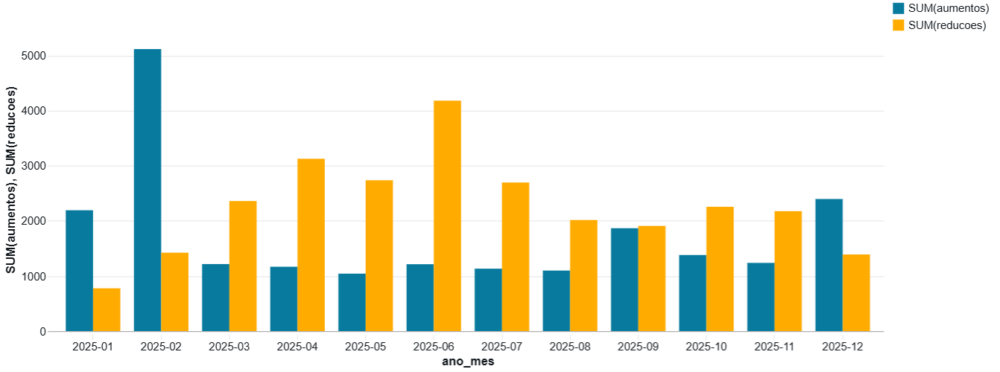

# MVP – Preços de Combustíveis no Brasil (ANP, 2025)

Trabalho final de MVP – Departamento de Engenharia de Produção / UnB
Autor: José Marcos Pereira Carneiro
Plataforma: Databricks Free Edition

---

## 1. Objetivo

### Problema
O preço dos combustíveis varia bastante entre estados, entre postos e ao longo do ano. Para quem abastece, seja um motorista ou um gestor de frota, a pergunta prática é: **onde, quando e com qual combustível se gasta menos?** Este MVP usa os dados públicos da ANP de 2025 para responder a essa pergunta com evidência.

### Hipótese
As diferenças de preço entre regiões, bandeiras e combustíveis são grandes o suficiente para justificar uma decisão de abastecimento orientada por dados.

### Perguntas de negócio
1. Quais estados tiveram o maior e o menor preço médio de gasolina comum e de etanol em 2025, e qual a diferença percentual entre esses extremos?
2. Postos de bandeira branca praticam preços menores que os postos de grandes distribuidoras? Qual é a diferença média?
3. Como o preço médio evoluiu mês a mês em 2025 e em quais meses ocorreram as maiores variações?
4. Em quais estados o etanol foi economicamente vantajoso em relação à gasolina (relação de preços ≤ 70%) e em quantos meses do ano?
5. Os postos repassam as reduções de preço com a mesma velocidade com que repassam os aumentos?

> As perguntas permanecem íntegras até o final do trabalho, inclusive as que não puderem ser respondidas. O atingimento de cada uma é discutido na seção de Autoavaliação.

---

## 2. Coleta

### Origem dos dados
Os dados vêm do **Levantamento de Preços de Combustíveis (LPC)** da ANP, uma pesquisa semanal feita por empresa contratada pela agência, que registra o preço de venda praticado em uma amostra de postos de todo o país. A ANP publica os resultados no portal de dados abertos, agrupados por semestre.

| Item | Valor |
|---|---|
| Fonte | ANP – Série Histórica de Preços de Combustíveis (Combustíveis Automotivos) |
| Página | https://www.gov.br/anp/pt-br/centrais-de-conteudo/dados-abertos/serie-historica-de-precos-de-combustiveis |
| Arquivos | `ca-2025-01.zip` (1º semestre) e `ca-2025-02.zip` (2º semestre) |
| Data da coleta | 21/10/2026 |
| Formato original | Um CSV dentro de cada .zip; separador `;`; codificação UTF-8; decimal com vírgula; data no formato dd/mm/aaaa |
| Volume | **813.731 linhas** (429.523 no 1º semestre e 384.208 no 2º) e 16 colunas |
| Licença | Creative Commons Attribution (CC-BY) |

### Como a coleta foi feita
1. Os dois arquivos .zip foram baixados manualmente do portal da ANP. Não foi necessário robô de coleta (web scraping), porque os dados são publicados em arquivo para download.
2. Os arquivos foram enviados para um **volume** no Databricks (`workspace.combustiveis.raw`), uma pasta de armazenamento na nuvem.
3. O notebook [`01_coleta_bronze`](notebooks/01_coleta_bronze.py) descompacta os arquivos, lê os CSVs e grava a tabela **`workspace.combustiveis.bronze_precos`** no formato Delta, sem alterar o conteúdo.

### Persistência na nuvem
Ao final da coleta, os dados estão persistidos em dois lugares no Databricks:
- **Arquivos brutos:** volume `workspace.combustiveis.raw` (os .zip e os CSVs extraídos);
- **Tabela Bronze:** `workspace.combustiveis.bronze_precos`, com 813.731 linhas.

Evidências:
- Workspace do Databricks: [`evidencias/01_workspace.png`](evidencias/01_workspace.png)
- Arquivos no volume: [`evidencias/02_volume_raw_arquivos.png`](evidencias/02_volume_raw_arquivos.png)
- Contagem de linhas por arquivo: [`evidencias/03_contagem_bronze.png`](evidencias/03_contagem_bronze.png)
- Tabela Bronze no catálogo: [`evidencias/04_tabela_bronze_catalog.png`](evidencias/04_tabela_bronze_catalog.png)

### Dados pessoais (LGPD)
A base identifica os postos pelo CNPJ e pela razão social, ou seja, são dados de **pessoas jurídicas**, divulgados publicamente pela própria ANP. Não há dados de pessoas físicas. Mesmo assim, por cautela, os endereços são descartados na camada Silver (não são usados em nenhuma pergunta), e todas as análises são feitas de forma **agregada** (por estado, bandeira e mês), sem expor postos individualmente.

---

## 3. Modelagem e Catálogo de Dados

### 3.1 Modelo de dados: Esquema Estrela
A camada Gold organiza os dados em um **esquema estrela**: uma tabela fato central com o preço de venda, ligada a cinco dimensões que descrevem **quando**, **onde**, **o quê**, **quem** e **qual bandeira**.

**Grão da fato:** um preço de venda por posto, produto e dia de coleta.

| Tabela | Tipo | Linhas | Chave |
|---|---|---|---|
| `gold_fato_preco` | Fato | 804.617 | — |
| `gold_dim_tempo` | Dimensão | 274 | `data` |
| `gold_dim_local` | Dimensão | 419 | `id_local` |
| `gold_dim_produto` | Dimensão | 6 | `id_produto` |
| `gold_dim_posto` | Dimensão | 8.706 | `id_posto` |
| `gold_dim_bandeira` | Dimensão | 49 | `id_bandeira` |

As chaves primárias e estrangeiras foram declaradas no Databricks e aparecem no catálogo (selo FK nas colunas da fato).

📄 Diagrama completo e justificativa das escolhas: [`catalogo/modelo_estrela.md`](catalogo/modelo_estrela.md)

### 3.2 Catálogo de Dados
O catálogo descreve cada atributo das seis tabelas: tipo, descrição, domínio (mínimo e máximo dos números e categorias dos textos), obrigatoriedade e linhagem.

📄 Catálogo completo: [`catalogo/catalogo_dados.md`](catalogo/catalogo_dados.md)

Resumo dos domínios principais:

| Atributo | Domínio |
|---|---|
| Período | 01/01/2025 a 31/12/2025 (274 dias com coleta, 12 meses) |
| Cobertura | 5 regiões, 27 UFs, 419 municípios, 8.706 postos |
| Produtos | Gasolina, gasolina aditivada, etanol, diesel, diesel S10, GNV |
| Preço de venda | R$ 3,09 (etanol) a R$ 9,59 (gasolina aditivada) |
| Bandeiras | 49, classificadas em: bandeira branca (33,1% dos preços), grandes distribuidoras (58,3%) e outras (8,6%) |

## 4. Carga (pipeline ETL)

O pipeline segue a **arquitetura medalhão**, em que cada camada é uma tabela Delta no schema `workspace.combustiveis`:

| Camada | Tabela | Notebook | O que contém |
|---|---|---|---|
| Bronze | `bronze_precos` | [`01_coleta_bronze`](notebooks/01_coleta_bronze.py) | Dado bruto, igual à fonte, todas as colunas como texto |
| Silver | `silver_precos` | [`02_transformacao_silver`](notebooks/02_transformacao_silver.sql) | Dado limpo, tipado e sem duplicidade |
| Gold | `gold_fato_preco` + 5 dimensões | [`03_modelagem_gold`](notebooks/03_modelagem_gold.sql) | Modelo estrela para a análise |

### 4.1 Bronze → Silver: regras de transformação

Antes de limpar, o notebook 02 faz um **diagnóstico** da camada Bronze, de modo que cada regra é justificada por um número:

| Diagnóstico | Resultado |
|---|---|
| Total de linhas na Bronze | 813.731 |
| Linhas totalmente em branco | 9.114 |
| `valor_de_compra` preenchido | 0 linhas (coluna vazia) |
| Produtos diferentes | 6 (gasolina, gasolina aditivada, etanol, diesel, diesel S10, GNV) |
| Bandeiras diferentes | 49 |
| Duplicatas reais (posto + produto + dia) | 0 |
| Unidade do GNV | escrita de dois jeitos: `R$ / m³` e `R$ / m3` |

Regras aplicadas:

| # | Regra | Motivo |
|---|---|---|
| R1 | Tirar espaços sobrando dos textos e transformar texto vazio em nulo | CNPJ e outros campos vêm com espaço na frente |
| R2 | Deixar o CNPJ só com números | Padronizar a chave que identifica o posto |
| R3 | Converter o preço de texto (`"5,59"`) para número (`5.59`) | Permitir cálculos |
| R4 | Converter a data de texto (`19/06/2025`) para data | Permitir agrupar por mês |
| R5 | Descartar `valor_de_compra` | Coluna 100% vazia |
| R6 | Descartar as colunas de endereço | Não são usadas em nenhuma pergunta (minimização de dados) |
| R7 | Remover linhas vazias, sem preço, com preço zero ou sem data | Os arquivos da ANP têm 9.114 linhas em branco |
| R8 | Manter um único preço por posto, produto e dia | Proteção contra dupla contagem (hoje não há duplicatas) |
| R9 | Corrigir o nome do arquivo de origem (`%20` → espaço) | Deixar a linhagem legível |
| R10 | Padronizar a unidade do GNV (`R$ / m3` → `R$ / m³`) | A mesma unidade aparece escrita de dois jeitos |

**Resultado:** a Silver tem **804.617 linhas**. A diferença para a Bronze (9.114) é exatamente o número de linhas em branco, ou seja, nenhum registro com dado real foi perdido.

Evidências:
- Diagnóstico da Bronze: [`evidencias/05_diagnostico_bronze.png`](evidencias/05_diagnostico_bronze.png)
- Contagem Bronze × Silver: [`evidencias/06_contagem_silver.png`](evidencias/06_contagem_silver.png)
- Tipos das colunas da Silver: [`evidencias/07_tipos_silver.png`](evidencias/07_tipos_silver.png)

### 4.2 Silver → Gold: carga do modelo estrela

O notebook 03 cria as tabelas na seguinte ordem:

1. Apaga a tabela fato antiga, para permitir recriar as dimensões sem conflito de chaves.
2. Cria as cinco dimensões a partir dos valores distintos da Silver. As chaves `id_...` são geradas com `ROW_NUMBER` (chave substituta); a dimensão tempo usa a própria data como chave.
3. Cria a tabela fato, trocando os textos da Silver pelos códigos das dimensões (JOIN).
4. Declara as chaves primárias e estrangeiras.
5. Confere se a fato tem o mesmo número de linhas da Silver.

Regras de negócio aplicadas na Gold:

| Regra | Onde | Descrição |
|---|---|---|
| G1 | `gold_dim_produto.grupo` | Gasolina comum + aditivada → GASOLINA; diesel + diesel S10 → DIESEL |
| G2 | `gold_dim_bandeira.tipo_bandeira` | BRANCA → bandeira branca; VIBRA, RAIZEN e IPIRANGA → grande distribuidora; demais → outras distribuidoras |
| G3 | `gold_dim_posto.revenda` | Se o mesmo CNPJ aparece com mais de um nome, fica um só |

**Resultado:** a fato tem **804.617 linhas**, exatamente o mesmo número da Silver. Isso confirma que nenhum registro se perdeu na carga.

Pipeline completo: **813.731** (Bronze) → **804.617** (Silver) → **804.617** (Gold).

Evidências:
- Contagem das tabelas Gold: [`evidencias/08_contagem_gold.png`](evidencias/08_contagem_gold.png)
- Tabelas Gold no catálogo: [`evidencias/09_tabelas_gold_catalog.png`](evidencias/09_tabelas_gold_catalog.png)
- Chaves estrangeiras da fato: [`evidencias/10_relacionamentos_gold.png`](evidencias/10_relacionamentos_gold.png)
- Teste de consulta no modelo estrela: [`evidencias/11_consulta_estrela.png`](evidencias/11_consulta_estrela.png)

## 5. Análise
### 5.1 Qualidade dos dados

A análise de qualidade está no notebook [`04_qualidade_dados`](notebooks/04_qualidade_dados.sql) e verifica, **atributo por atributo**, as dimensões de qualidade sobre os dados já limpos. Os problemas encontrados na camada Bronze (linhas em branco, coluna vazia, unidade escrita de dois jeitos) foram tratados antes, no notebook 02 (seção 4.1).

| Dimensão | Como foi verificada | Resultado | Decisão |
|---|---|---|---|
| **Completude** | Nulos em cada um dos 11 atributos | 0 nulos em todos | Nenhuma ação |
| **Unicidade** | Total de linhas × chaves distintas em todas as tabelas | Todas as chaves únicas; o grão da fato (posto + produto + dia) não se repete | Nenhuma ação |
| **Consistência entre tabelas** | Códigos da fato sem par nas dimensões (órfãos) | 0 órfãos | Nenhuma ação |
| **Consistência entre atributos** | Estado em mais de uma região; posto em mais de um município | Nenhum estado inconsistente; 3 postos (0,03%) em mais de um município | Mantidos (impacto desprezível) |
| **Conformidade** | Cada regra de domínio do Catálogo de Dados | 0 valores fora do domínio; 27 UFs; datas dentro de 2025 e do semestre do arquivo | Nenhuma ação |
| **Acurácia** | Preços atípicos pela regra do boxplot (Q1 − 1,5×IQR e Q3 + 1,5×IQR), por produto | De 0,6% a 2,6% de atípicos por produto | Mantidos (ver abaixo) |
| **Atualidade e cobertura** | Dias de coleta, preços e postos por mês | 12 meses cobertos; agosto com cerca de 20% menos preços | Volume suficiente em todos os meses |

**Preços atípicos por produto:**

| Produto | Q1 | Q3 | Limite inferior | Limite superior | Atípicos abaixo | Atípicos acima | % atípicos |
|---|---|---|---|---|---|---|---|
| DIESEL | 5,89 | 6,38 | 5,16 | 7,12 | 0 | 1.980 | 2,30% |
| DIESEL S10 | 5,94 | 6,39 | 5,27 | 7,07 | 10 | 3.509 | 2,43% |
| ETANOL | 4,09 | 4,79 | 3,04 | 5,84 | 0 | 1.091 | 0,61% |
| GASOLINA | 5,99 | 6,47 | 5,27 | 7,19 | 273 | 3.206 | 1,64% |
| GASOLINA ADITIVADA | 6,19 | 6,68 | 5,46 | 7,42 | 106 | 2.574 | 1,62% |
| GNV | 4,39 | 4,99 | 3,49 | 5,89 | 5 | 472 | 2,62% |

**Por que os atípicos foram mantidos:** um valor fora do normal não é necessariamente um erro. Os 10 maiores preços de gasolina comum (R$ 9,29) estão em Barueri e Tatuí (SP) e, no caso de Barueri, se repetem semana após semana entre outubro e dezembro. Esse padrão estável indica o preço real de um posto específico, e não erro de digitação. Como representam menos de 3% dos registros de cada produto, os atípicos também não distorcem as médias de forma relevante.

**Observações que afetam a análise:**
- **393 postos trocaram de bandeira** durante o ano e 109 mudaram de nome. Isso confirma a decisão de modelar a bandeira em uma dimensão separada do posto: cada preço fica associado à bandeira daquele dia.
- **Frequência de observação:** cada combinação posto + produto foi coletada em média 23 vezes no ano (mediana 22), e 64% delas foram coletadas 12 vezes ou mais. Isso permite acompanhar a variação de preço de cada posto ao longo do tempo (pergunta 5).

**Conclusão:** depois da limpeza, a base não apresenta problemas que comprometam as respostas às perguntas de negócio.

Evidências:
- Completude: [`evidencias/12_qualidade_completude.png`](evidencias/12_qualidade_completude.png)
- Unicidade: [`evidencias/13_qualidade_unicidade.png`](evidencias/13_qualidade_unicidade.png)
- Conformidade: [`evidencias/14_qualidade_conformidade.png`](evidencias/14_qualidade_conformidade.png)
- Preços atípicos: [`evidencias/15_qualidade_atipicos.png`](evidencias/15_qualidade_atipicos.png)
- Cobertura mensal: [`evidencias/16_qualidade_cobertura_mensal.png`](evidencias/16_qualidade_cobertura_mensal.png)

### 5.2 Respostas às perguntas

As consultas, os gráficos e a discussão completa de cada pergunta estão no notebook [`05_analise`](notebooks/05_analise.sql). Abaixo, o resumo de cada resposta.

#### Pergunta 1 – Onde abastecer?
*Quais estados tiveram o maior e o menor preço médio de gasolina comum e de etanol em 2025, e qual a diferença percentual entre esses extremos?*

| Produto | Mais caro | Mais barato | Diferença | Em um tanque de 50 L |
|---|---|---|---|---|
| Gasolina comum | AC – R$ 7,67 | PI – R$ 5,93 | **29,5%** | R$ 87,28 |
| Etanol | AC – R$ 5,45 | MS – R$ 4,08 | **33,6%** | R$ 68,60 |

O **Acre** é o mais caro nos dois produtos, e a região Norte concentra as gasolinas mais caras (AC, AM, RR e RO). O etanol é mais barato nos estados produtores do Centro-Sul (MS, SP, MT e MG). Em ambos os casos, o padrão é compatível com o peso da logística no preço final.

Evidência dos extremos: [`evidencias/18_p1_extremos.png`](evidencias/18_p1_extremos.png)

#### Pergunta 2 – Em qual posto abastecer?
*Postos de bandeira branca praticam preços menores que os postos de grandes distribuidoras? Qual é a diferença média?*

- **No país:** a bandeira branca é mais barata em 5 dos 6 produtos, de 2,8% a 4,6%. Na gasolina comum, a diferença é de **R$ 0,184/L (3,0%)**. A exceção é o GNV, em que a branca é 1,4% mais cara.
- **Dentro de cada estado** (gasolina): a branca é mais barata em **20 dos 27 estados**, mas a diferença média entre estados é de apenas **R$ 0,061/L**. A média nacional é maior porque estados com muitos postos na amostra e grande vantagem da branca, como SP (R$ 0,35), pesam mais (efeito composição).
- **Exceções:** em 7 estados a branca é igual ou mais cara, com destaque para o Amazonas (+R$ 0,57).

**Resposta:** sim, na maioria dos casos, mas a vantagem é moderada e não vale para todos os estados.

Evidência do resumo por estado: [`evidencias/21_p2_resumo_estados.png`](evidencias/21_p2_resumo_estados.png)

#### Pergunta 3 – Quando abastecer?
*Como o preço médio evoluiu mês a mês em 2025 e em quais meses ocorreram as maiores variações?*

- **Fevereiro** teve as três maiores altas do ano: diesel S10 **+4,74%**, etanol **+4,05%** e gasolina **+2,96%**. O movimento coincide com o aumento do ICMS fixo em 1º de fevereiro de 2025 (+R$ 0,10/L na gasolina, +R$ 0,06/L no diesel), mas a alta observada foi maior que o imposto.
- **Março a agosto:** queda gradual. A maior queda foi a do diesel S10 em maio (**−2,40%**).
- **Setembro a dezembro:** estabilidade, exceto pela alta do etanol em dezembro (+1,94%).
- **No ano** (dezembro × janeiro): gasolina +0,31%, etanol +3,70%, diesel S10 −1,17%.

**Resposta:** houve um único choque relevante (fevereiro). Fora dele, as variações mensais ficaram quase sempre abaixo de 1%.

Evidências: [`evidencias/23_p3_maiores_variacoes.png`](evidencias/23_p3_maiores_variacoes.png) · [`evidencias/24_p3_acumulado_ano.png`](evidencias/24_p3_acumulado_ano.png)

#### Pergunta 4 – Com qual combustível abastecer?
*Em quais estados o etanol foi economicamente vantajoso em relação à gasolina (relação de preços ≤ 70%) e em quantos meses do ano?*

| Situação | Estados |
|---|---|
| Etanol compensou o ano todo | **MS** (65,6%), **MT** (66,4%), **SP** (67,4%) |
| Etanol compensou em parte do ano | **PR** (10 meses), **GO** (4), **MG** (3), **DF** (1) |
| Gasolina compensou o ano todo | Os outros 20 estados |

**Resposta:** o etanol só foi vantajoso no **Centro-Sul**, a região produtora. No Norte e no Nordeste, a gasolina compensou em todos os meses. O caso extremo é o Amapá, onde o etanol custou 90,2% do preço da gasolina.

Evidência: [`evidencias/26_p4_situacao_estados.png`](evidencias/26_p4_situacao_estados.png)

#### Pergunta 5 – Os aumentos chegam mais rápido que as reduções?
*Os postos repassam as reduções de preço com a mesma velocidade com que repassam os aumentos?*

Comparando cada preço de gasolina com a coleta anterior do mesmo posto (203.788 comparações): 76,4% sem mudança, **13,3% reduções** (média de R$ 0,146) e **10,3% aumentos** (média de R$ 0,197). Os aumentos são menos frequentes, porém **35% maiores**. Fevereiro concentrou 5.116 aumentos, e a volta do preço foi diluída ao longo de seis meses.

**Resposta: inconclusiva.** O padrão é **compatível** com o fenômeno "foguetes e penas" (sobe de uma vez, desce aos poucos), mas a base não tem o **custo** do posto (a coluna `valor_de_compra` veio vazia) nem as datas de reajuste das refinarias. Sem o custo, não dá para distinguir "repasse lento" de "custo que também caiu devagar".

Evidência: [`evidencias/27_p5_aumentos_reducoes.png`](evidencias/27_p5_aumentos_reducoes.png)

### 5.3 Discussão geral

**A hipótese foi confirmada:** as diferenças de preço são grandes o suficiente para justificar decisões orientadas por dados. Mas cada decisão pesa de forma muito diferente. Convertendo tudo para um **tanque de 50 litros de gasolina**:

| Decisão | Diferença por tanque | Peso |
|---|---|---|
| **Onde** abastecer (estado) | R$ 87,28 | Muito alto |
| **Com qual combustível** | Depende da região: o etanol compensa só no Centro-Sul | Alto, mas regional |
| **Em qual posto** (bandeira) | R$ 3,05 a R$ 9,20 | Moderado |
| **Quando** (pico × vale do ano) | R$ 9,25 | Baixo e concentrado em um mês |

1. **A localização é o fator dominante:** a diferença entre estados é cerca de dez vezes maior que a de bandeira ou de época do ano. Para quem tem flexibilidade de rota, como frotas e transportadoras, planejar onde abastecer é a decisão que mais economiza.
2. **A escolha do combustível é regional:** não existe resposta nacional. No Centro-Sul o etanol compete; no Norte e no Nordeste, não.
3. **A bandeira branca é critério de desempate**, não regra.
4. **O momento importou pouco em 2025**, exceto por um choque pontual em fevereiro.
5. **A dinâmica sugere assimetria entre altas e quedas**, mas confirmá-la exige dados de custo que a base não tem.

**Limitações gerais:** a pesquisa da ANP é uma amostra (419 municípios, 8,7 mil postos), e não um censo. As médias são simples, sem ponderação por volume vendido. A análise cobre apenas 2025.

## 6. Autoavaliação

**1. Quais perguntas foram respondidas e quais não foram? Por quê?**

| Pergunta | Situação | Comentário |
|---|---|---|
| 1 – Estados mais caros e mais baratos | ✅ Respondida | Os dados têm cobertura das 27 UFs em todos os meses |
| 2 – Bandeira branca × grandes distribuidoras | ✅ Respondida, com ressalva | A comparação por estado mostrou que a média nacional superestima a vantagem da bandeira branca |
| 3 – Evolução mês a mês | ✅ Respondida | Cobertura mensal equilibrada (análise de qualidade). Vale só para 2025 |
| 4 – Etanol × gasolina (regra dos 70%) | ✅ Respondida | A regra dos 70% é uma aproximação; o rendimento real varia por veículo |
| 5 – Repasse de altas e baixas | ⚠️ Inconclusiva | O padrão observado é compatível com a assimetria, mas falta a variável de custo para provar a causa |

A pergunta 5 foi formulada já sabendo do risco de não ser respondida, e foi mantida intacta, como pede o enunciado. Um ponto aprendido: a análise de qualidade mostrou que a **frequência de coleta** era suficiente (cada posto observado em média 23 vezes no ano). O que impediu a resposta não foi o volume de dados, e sim a **ausência de uma variável**. Isso reforça a importância de mapear, ainda na fase de objetivo, quais variáveis cada pergunta exige.

**2. Que limitações dos dados condicionaram os resultados?**
- **Amostra, não censo:** o LPC cobre 419 municípios e cerca de 8,7 mil postos, então estados com poucos municípios pesquisados podem não estar bem representados.
- **Sem volume vendido:** as médias tratam igualmente um posto de rodovia e um de bairro.
- **Sem custo de aquisição:** a coluna `valor_de_compra` veio 100% vazia, o que inviabilizou a pergunta 5.
- **Um único ano:** não permite falar em sazonalidade, só no comportamento de 2025.
- **Problemas de formatação** na fonte (9.114 linhas em branco, decimal com vírgula, unidade do GNV escrita de dois jeitos), todos tratados na camada Silver.

**3. Que decisões técnicas eu tomaria de outra forma?**
- **Automatizar o download** dos arquivos da ANP dentro do pipeline, em vez do upload manual, para que a coleta também fosse reproduzível por código.
- **Gerar os gráficos por código** (Python), em vez de pela interface do Databricks. Os gráficos da interface não ficam salvos no arquivo do notebook exportado para o GitHub.
- Incluir desde o início uma **segunda fonte com o custo** (preços de distribuição da ANP), que teria permitido responder à pergunta 5.

**4. Que extensões transformariam este MVP em uma solução de uso contínuo?**
- **Carga incremental semanal:** a ANP publica o arquivo "Quatro últimas semanas", e um Job agendado poderia acrescentar os novos preços toda semana, em vez de recarregar o ano inteiro.
- **Série histórica de vários anos**, para separar padrões sazonais de choques pontuais.
- **Cruzamento com custos** de distribuição e reajustes das refinarias, para medir o repasse (pergunta 5).
- **Painel (dashboard)** no Databricks para o usuário final, com filtros por estado, produto e bandeira, e um alerta de "etanol compensa no seu estado este mês".
- **Ponderação por volume**, cruzando com os dados de vendas por estado também publicados pela ANP.

## 7. Licença
- **Código:** MIT (ver arquivo `LICENSE`).
- **Dados:** Série Histórica de Preços de Combustíveis – ANP, publicada como dado aberto sob licença Creative Commons Attribution (CC-BY), que permite redistribuição e uso derivado com atribuição da fonte.

## Estrutura do repositório
| Caminho | Conteúdo |
|---|---|
| `README.md` | Este documento |
| `/notebooks` | Notebooks de coleta, transformação, carga e análise |
| `/catalogo` | Catálogo de Dados e diagrama do modelo |
| `/evidencias` | Capturas de tela da execução na nuvem |
| `LICENSE` | Licença do código |
