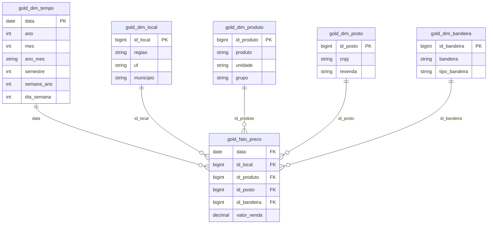

# Modelo de dados – Esquema Estrela

Camada Gold do pipeline, no schema `workspace.combustiveis` do Databricks.

**Grão da tabela fato:** um preço de venda por **posto**, **produto** e **dia de coleta**.

## Por que esse modelo

| Escolha | Justificativa |
|---|---|
| Esquema estrela (e não snowflake) | As dimensões são pequenas e simples; separar em hierarquias não traria ganho e deixaria as consultas mais longas |
| Bandeira em dimensão própria, separada do posto | Um posto pode trocar de bandeira durante o ano; com a bandeira na fato, cada preço fica associado à bandeira daquele dia |
| Chave da dimensão tempo é a própria data | A data já é única e legível; não há necessidade de código artificial |
| Demais dimensões com chave substituta (`id_...`) | A fato guarda códigos numéricos curtos no lugar de textos repetidos |
| Coluna `grupo` em produto | Permite comparar gasolina com etanol sem misturar comum e aditivada (pergunta 4) |
| Coluna `tipo_bandeira` | Implementa a regra de negócio da pergunta 2 (branca × grandes distribuidoras) |

## Como cada pergunta usa o modelo

| Pergunta | Dimensões usadas |
|---|---|
| 1. Estados com maior e menor preço | local, produto |
| 2. Bandeira branca × grandes distribuidoras | bandeira, produto |
| 3. Evolução mês a mês | tempo, produto |
| 4. Etanol × gasolina (regra dos 70%) | local, tempo, produto |
| 5. Repasse de altas e baixas | tempo, posto, produto |
